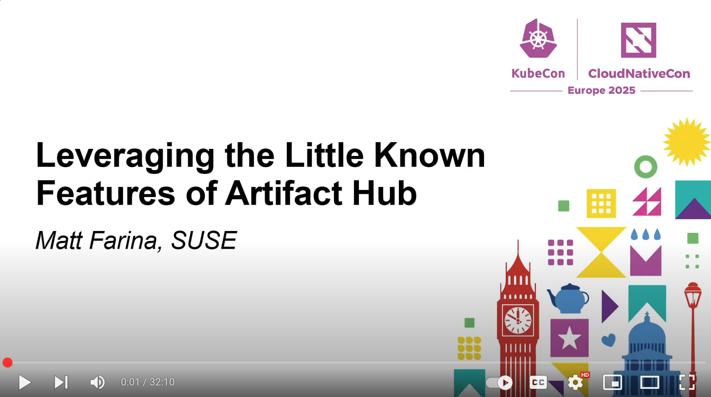

At KubeCon/CloudNativeCon 2025 in London we went deeper on Artifact Hub than was [presented at KubeCon/CloudNativeCon NA](https://blog.artifacthub.io/blog/kubecon-na-24-video/). It covered webhooks, notifications, describing artifacts in more detail, authorization for teams, and more. The video from this presentation is online and available [here](https://www.youtube.com/watch?v=HEhnch8Wpj8).